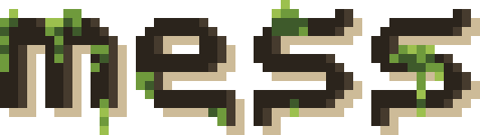
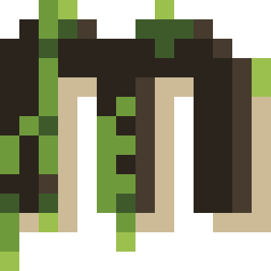

<picture>
  <source media="(prefers-color-scheme: dark)" srcset="assets/wordmark/dark.svg">
  
</picture>

_manage your month from the terminal_

<!-- what mess is, in two or three sentences -->

## features

<!-- what mess can do, as a short list -->

## install

<!-- how to install mess -->

## commands

<!-- a table of commands and what each one does -->

<picture>
  <source media="(prefers-color-scheme: dark)" srcset="assets/icon/dark.svg">
  
</picture>

